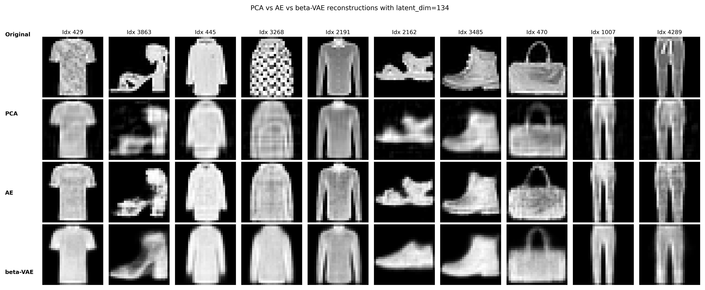
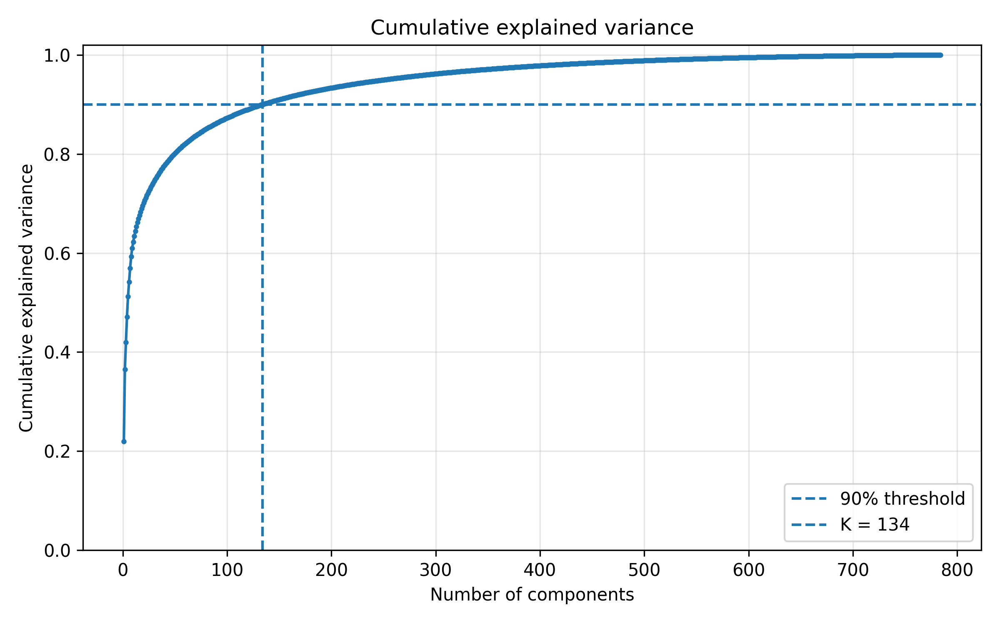
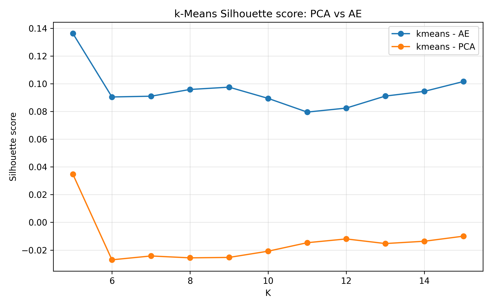

# Representation Learning: PCA, Autoencoders & β-VAE

**Comparing linear and neural representation learning methods for image reconstruction and unsupervised clustering.**

This project investigates dimensionality reduction and latent representation learning using a reduced Fashion-MNIST dataset.

Three approaches are explored: Principal Component Analysis (PCA), deterministic Autoencoders (AE), and β-Variational Autoencoders (β-VAE). Their learned representations are analyzed through image reconstruction, latent-space visualization, and clustering experiments.

## Reconstruction Results



The project compares how different representation learning methods preserve visual information when compressing grayscale images.

## Methodology

### 1. Data Preprocessing

- Fashion-MNIST grayscale images (28 × 28 pixels).
- Pixel normalization to [0, 1].
- Stratified 80/20 train-test split.
- Training-only fitting of preprocessing parameters to prevent data leakage.

### 2. Principal Component Analysis

PCA is implemented using NumPy and Singular Value Decomposition (SVD).

The number of principal components is selected to preserve at least 90% of the cumulative explained variance.



### 3. Deterministic Autoencoder

A fully connected neural network learns nonlinear compressed representations by minimizing reconstruction error.

The autoencoder uses an encoder-decoder architecture implemented in PyTorch.

### 4. β-Variational Autoencoder

A β-VAE is implemented to explore probabilistic latent representations.

Its training objective combines reconstruction error and KL-divergence regularization, controlled by the β parameter.

### 5. Clustering Evaluation

The project evaluates learned representations using K-Means and Gaussian Mixture Models (GMM), comparing clustering behavior across different latent spaces.



## Technologies

- Python
- NumPy
- Pandas
- PyTorch
- Scikit-learn
- Matplotlib

## Project Structure

```text
.
├── docs/             # Academic report and technical notes
├── notebooks/        # Experimental notebook
├── results/
│   ├── figures/      # Visualizations and comparisons
│   ├── models/       # Saved models
│   └── tables/       # Experimental results
├── src/
│   ├── autoencoders.py
│   ├── clustering.py
│   ├── data.py
│   ├── decomposition.py
│   ├── metrics.py
│   ├── preprocessing.py
│   ├── utils.py
│   └── visualization.py
└── README.md
```

## Running the Project

The experimental workflow is available in:

`notebooks
